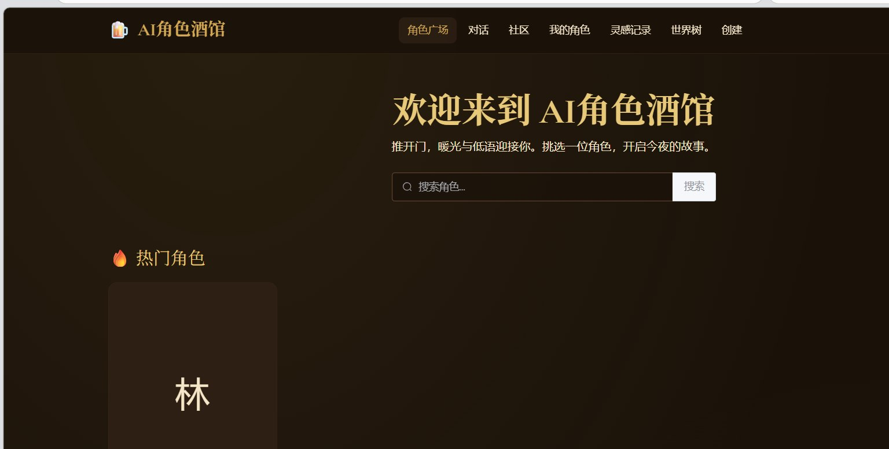
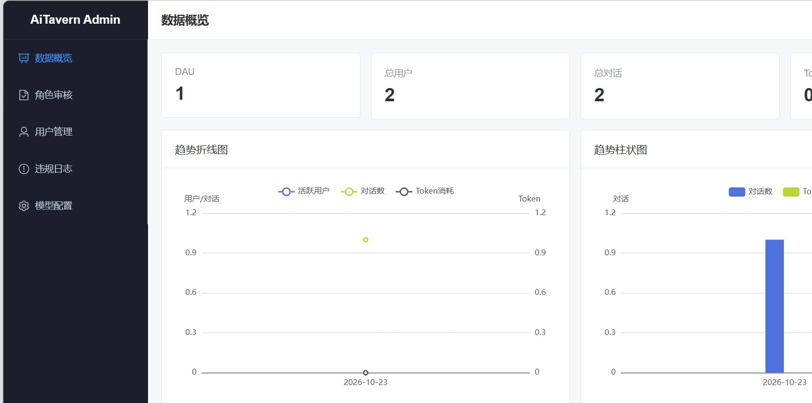
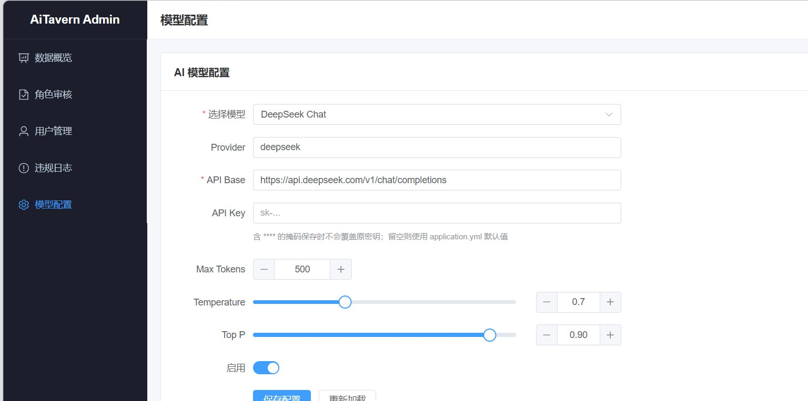

# AI 角色酒馆

基于大模型的角色扮演与叙事创作平台：创建 / 挑选角色卡，进行流式多轮对话，再把对话改写成小说或剧本并发布。配套管理端与 MCP 服务，把系统能力开放给 AI 客户端。

单体 Spring Boot + 双 Vue 3 前端 + 独立 Node.js MCP，个人独立开发。



| 管理端概览 | 模型配置 |
|---|---|
|  |  |

## 功能概览

- **流式对话**：后端 OkHttp 解析 SSE，前端 `fetch` + Stream 增量渲染（非整页刷新）
- **积分计费**：按 token 计量，扣余额 / 写流水 / 会话累计同一事务
- **MCP 开放**：9 个工具（角色卡、立绘、世界树、叙事改写、发布等），JWT 调后端 REST
- **叙事生成**：对话清洗后按文体 × 风格 × 篇幅组 Prompt，带 token 预算裁剪
- **内容审核**：归一化 + 间隔容错匹配，拦截常见拆字 / 谐音绕过
- **缓存与可视化**：热门榜与配置缓存；ECharts 看上下文占用、Token、缓存命中、MCP 耗时
- **模型热切换**：模型名 / base_url / 采样参数入库，未配 Key 时降级本地模拟流

## 技术栈

| 层 | 选型 |
|---|---|
| 后端 | JDK 17 · Spring Boot 3.2 · MyBatis · MySQL 8 · Redis · OkHttp · JWT |
| 前端 | Vue 3 · Pinia · Element Plus · Tailwind · ECharts · Vite |
| MCP | Node.js · `@modelcontextprotocol/sdk`（stdio） |
| AI | OpenAI 兼容 `/chat/completions`，流式 |

## 仓库结构

```
ai-tavern/           Spring Boot 后端（8080）
ai-tavern-web/       用户端 Vue 3（5173）
ai-tavern-admin/     管理端 Vue 3（5174）
ai-tavern-mcp/       MCP 服务
sql/                 schema.sql · seed.sql
scripts/             SillyTavern 角色卡导入
```

## 快速开始

**1. 环境变量**（仓库不含密钥；也可用被 gitignore 的 `application-local.yml`）

```bash
DB_USERNAME=root
DB_PASSWORD=你的密码
AI_API_KEY=                  # 不配则本地模拟流式
AI_BASE_URL=https://api.deepseek.com/v1
JWT_SECRET=
# OSS_* 不配则图片上传不可用
```

**2. 数据库**

```bash
mysql -uroot -p < sql/schema.sql
mysql -uroot -p < sql/seed.sql    # 可选
```

**3. 启动**

```bash
cd ai-tavern && mvn spring-boot:run -Dspring-boot.run.profiles=local
cd ai-tavern-web && npm install && npm run dev
cd ai-tavern-admin && npm install && npm run dev
```

MCP 接入见 [`ai-tavern-mcp/README.md`](ai-tavern-mcp/README.md)。

## 默认账号

- 管理端 `5174`：`admin` / `admin123`（演示用，部署前请改）
- 用户端 `5173`：自行注册

## 规模（约）

| 模块 | 说明 |
|---|---|
| 后端 | ~112 Java 文件 / 6600+ 行 · 22 表 · 90 REST · 38 单测 |
| 用户端 | ~19 组件 / 6200+ 行 |
| 管理端 | ~12 组件 / 1400+ 行 |
| MCP | 9 工具 |

## 安全

凭据只通过环境变量或未跟踪的 `application-local.yml` 注入；请勿提交本地密钥文件。
